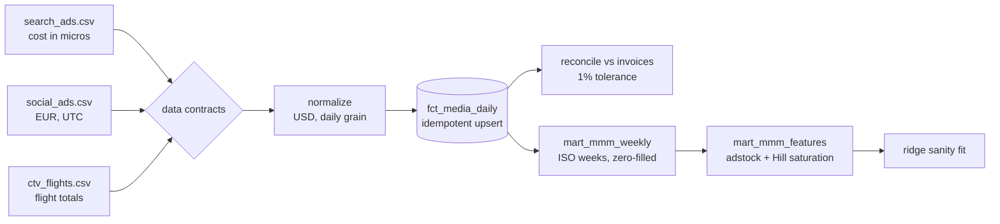

# mmm-input-pipeline

A pipeline that turns messy ad-platform exports into **model-ready Media Mix Modeling (MMM) inputs**, on DuckDB.

MMM projects rarely fail on the model. They fail on the inputs: spend in three currencies and two units, a CTV vendor that only sends flight totals, timezones that shift spend across days, and numbers nobody has reconciled to what finance was actually billed. This project is the data engineering half of MMM: get the inputs right, prove they are right, and make reruns safe.


## Pipeline



| Stage | What it guarantees |
|---|---|
| **Contracts** | Every file matches a declared schema (columns and types) or the run stops with a clear error. |
| **Normalize** | One grain: `date, channel, spend_usd, impressions`. Micros become dollars, EUR becomes USD with a daily FX table, CTV flight totals are spread evenly across flight days. |
| **Idempotent load** | Each batch replaces its own date range per channel inside a transaction. An ingestion log keyed by file checksum skips batches already loaded. Rerunning never double-counts. |
| **Reconcile** | Monthly platform spend is compared with billed invoices. Gaps over 1% are reported. |
| **Weekly mart** | Monday-start ISO weeks, one spend column per channel, zero-filled, partial weeks dropped. |
| **Features** | Geometric adstock (carryover) and Hill saturation (diminishing returns) per channel. |
| **Sanity fit** | A ridge regression of sign-ups on saturated media. It is a smoke test that the inputs carry signal, not the MMM itself. |

## Example run

```
$ python mmm_inputs.py --raw raw --db mmm.duckdb
new batch loaded
weeks in mart: 77
reconciliation issues (>1%): 0
sanity fit (signups ~ saturated media):
search_saturated    11486.5
social_saturated     9640.0
ctv_saturated       12926.6
r2                      0.698

$ python mmm_inputs.py --raw raw --db mmm.duckdb
batch already loaded, skipped (idempotent)
```

## Run it

```bash
pip install -r requirements.txt
python generate_exports.py --out raw
python mmm_inputs.py --raw raw --db mmm.duckdb
pytest -q
```

## Tests

- Contracts reject a missing column and a non-integer count.
- Micros, EUR and flight totals all normalize to the right USD totals.
- Loading the same batch twice, or a restated batch, never duplicates rows.
- A 5% billing gap on one month of social spend is caught by reconciliation, and nothing else is flagged.
- The weekly mart starts every week on Monday and keeps every dollar of spend.
- Adstock and Hill transforms match hand-calculated values.

## Going to production

| Concern | Here | At scale |
|---|---|---|
| Sources | CSV files | Platform APIs or reverse-ETL landings in GCS/S3 |
| Warehouse | DuckDB | BigQuery, with `MERGE` on (channel, date) partitions |
| Orchestration | CLI | Airflow: one task per source, then reconcile, mart and features |
| Contracts | Python dict | dbt model contracts or a schema registry |
| Alerting | printed report | Reconciliation gaps posted to the marketing finance channel |

## Data

All data is synthetic, generated by `generate_exports.py`. Sign-ups are simulated from adstocked, saturated spend, so the pipeline has a known ground truth to recover.
